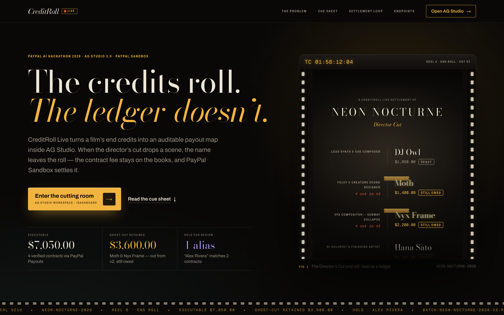
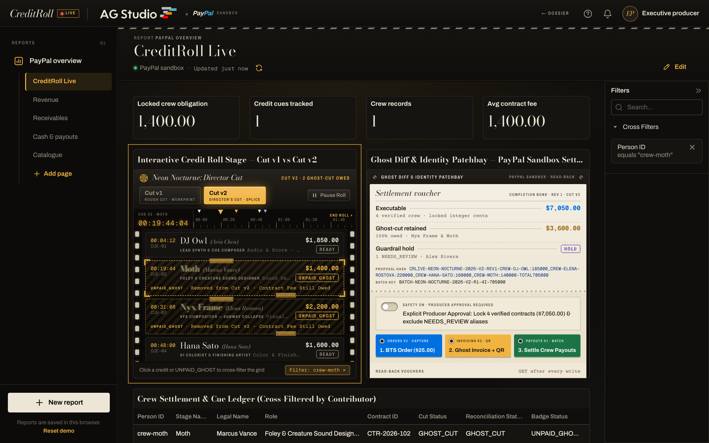
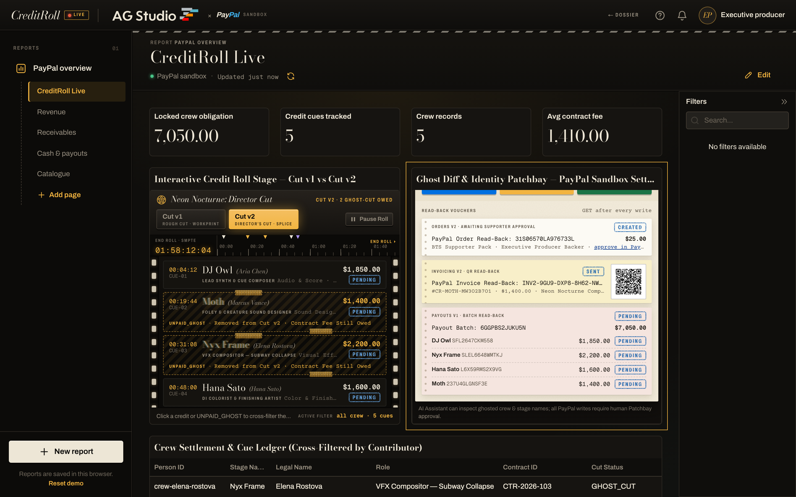

# CreditRoll Live — Interactive Cinema End-Credits & PayPal Sandbox Settlement Studio

> **PayPal AI Hackathon 2026 Submission** · Built with **PayPal Sandbox REST API** (`Orders v2`, `Invoicing v2 + QR Code`, `Batch Payouts v1`), **AG Studio 3.0 Custom Widgets & Studio Agent Framework**, and **Next.js 16**.

**CreditRoll Live** transforms the rolling end-credits of an independent film, animation, or indie game inside **AG Studio** into an interactive, auditable financial map powered by AI reconciliation, deterministic financial guardrails, and live **PayPal Sandbox** money movement.

---

## Visual Gallery

### The screening room — `/`

The home page reads the Director's Cut end roll as a ledger. Every credit carries its locked contract fee, the two names cut from v2 burn through the 35mm gate as `UNPAID_GHOST` double exposures, and the figures — $7,050.00 executable, $3,600.00 ghost-cut retained, one alias on hold — are computed by the same reconciler that drives AG Studio.



### The cutting room — `/dashboard`, Director's Cut v2 cross-filtered to Moth

The Credit Roll Stage widget sits on a flatbed: a sprocket-lit strip, an SMPTE cue ruler, and cyan workprint (Cut v1) and amber splice-tape (Cut v2) keys. Clicking Moth's ghost credit cross-filters the AG Grid ledger, the KPI tiles and the Filters panel to `crew-moth`, while the Ghost Patchbay beside it holds the integer-cent settlement voucher behind the producer's approval switch.



### The read-back desk — live PayPal Sandbox, after all three Patchbay actions

Captured from a live PayPal Sandbox run, not a mock. With the producer's approval switch armed, the Patchbay fired all three writes and read each one back with `GET`:

- **Orders v2**: order `31S06570LA976733L` was created for the $25.00 supporter pack. PayPal holds it as `CREATED` until a supporter approves it, so the voucher carries PayPal's approve link instead of claiming a capture.
- **Invoicing v2**: Moth's ghost-cut invoice `INV2-9GU9-DXP8-8H62-NW6W` came back `SENT` for $1,400.00 with a scannable QR code.
- **Payouts v1**: batch `6GGPBS2JUKU5N` for $7,050.00 read back with all four items `PENDING`. Minutes later PayPal reported the batch `SUCCESS` and every item `UNCLAIMED`, because the demo crew addresses have no PayPal accounts, so no credit was ever stamped `PAID`.



---

## Why CreditRoll Live?

Independent film, animation, podcast, and indie game productions treat their end-credits roll as a static thank-you screen while managing contributor contracts, stage-name mapping, cut-edit changes, fan support, and PayPal payouts in disconnected spreadsheets:

1. **The "Ghost Credit" Cut Trap**: When a director trims a scene between the **Rough Cut (v1)** and the **Director's Cut (v2)**, a sound designer (`Moth`) or VFX artist (`Nyx Frame`) whose cue was cut often vanishes from the v2 credit roll—even though their approved fixed-fee contract remains legally owed and unpaid (`UNPAID_GHOST`).
2. **Stage-Name & Alias Mismatches**: Crew members credited under stage names (`DJ Owl`, `Moth`) or homonymous names (`Alex Rivera`) fail to match legal contract rosters, causing missed payouts or misdirected transfers.
3. **Batch Submission != Completed Settlement**: Submitting a payout batch does not mean every contributor was paid; individual items can return `SUCCESS`, `PENDING`, `UNCLAIMED`, or `FAILED` on read-back.

---

## Key Features

### 1. Two Native AG Studio Custom Widgets (`app/dashboard/studio/credit-roll-widgets.tsx`)
Registered via AG Studio's `createWidgets` API with full `formatShape` and `ai` metadata:
- **`credit-roll-stage` (Interactive Rolling Credit Roll Stage)**:
  - Playable, rewindable cinema end-credits roll with a **Cut v1 (Rough Cut) ↔ Cut v2 (Director's Cut)** toggle.
  - Highlights contributors cut in v2 as glowing translucent **`UNPAID_GHOST`** nodes (*"Removed from Cut v2 · Contract Fee Still Owed"*).
  - Clicking any contributor chip or ghost credit invokes `widgetApi.toggleCrossFilter(...)` on `personId`, cross-filtering the companion **AG Grid** (`crewSettlements`, `creditCues`, `crewMembers`) to that contributor's cues, contract, and PayPal receipts.
- **`ghost-patchbay` (Ghost Diff & Identity Patchbay)**:
  - Side-by-side v1→v2 cut diff, stage-name-to-legal-contract evidence links, deterministic guardrail status (`NEEDS_REVIEW` hold on ambiguous alias `Alex Rivera`), and human-in-the-loop approval controls for triggering PayPal Sandbox writes.

### 2. Deterministic Financial Guardrail Engine (`lib/credit-roll-reconciler.ts`)
- Calculates all monetary amounts strictly in **integer cents** from the locked contract roster; any AI-suggested fee override is discarded and logged in `discardedAiAmountOverrides`.
- Generates deterministic, version-bound `proposalVersionHash`, `senderBatchId`, and `PayPal-Request-Id` identifiers so repeated clicks are idempotently deduplicated.
- Blocks unverified or ambiguous recipients (`NEEDS_REVIEW`) before any PayPal network request is sent.

### 3. Two-Way PayPal Sandbox Write & Read-Back Loop (`lib/paypal.ts` & `lib/credit-roll-settlement.ts`)
All PayPal calls run server-side with `PayPal-Request-Id` idempotency headers and automatic `GET` resource read-back:
- **Behind-the-Scenes Supporter Pack (`Orders v2 CAPTURE`)**: `POST /v2/checkout/orders` (`intent: CAPTURE`) → `POST /v2/checkout/orders/{id}/capture` → `GET /v2/checkout/orders/{id}` (`/api/credit-roll/supporter-order`). Until a supporter approves the order at PayPal's approve link, PayPal answers the capture with `ORDER_NOT_APPROVED`; the order is then recorded as pending (`CREATED`) with that link rather than failed.
- **Ghost-Cut Obligation Invoice & Live QR Code (`Invoicing v2`)**: `POST /v2/invoicing/invoices` → `POST /v2/invoicing/invoices/{id}/send` → `POST /v2/invoicing/invoices/{id}/generate-qr-code` → `GET /v2/invoicing/invoices/{id}` (`/api/credit-roll/obligation-invoice`).
- **Idempotent Crew Batch Payouts (`Batch Payouts v1`)**: `POST /v1/payments/payouts` → `GET /v1/payments/payouts/{batch_id}` (`/api/credit-roll/settle`), stamping a contributor node as `PAID` **only** when their individual item `transaction_status` is `SUCCESS` (while preserving `PENDING`, `UNCLAIMED`, and `FAILED` states).

---

## Quick Start & Local Verification

### Prerequisites
- **Node.js 20.9+** (tested on Node.js 24.22.1)
- **PayPal Sandbox REST App** credentials from [developer.paypal.com](https://developer.paypal.com/dashboard/applications/sandbox) (optional for initial UI exploration; required for live PayPal Sandbox network calls)

### 1. Install & Configure
```bash
npm install
cp env.example .env.local
```

Fill in `.env.local` with your PayPal Sandbox credentials:
```env
PAYPAL_CLIENT_ID=your_sandbox_client_id
PAYPAL_SECRET=your_sandbox_secret
# Optional: AG Studio license key & OpenAI key for the built-in Studio AI chat
AG_STUDIO=
AG_STUDIO_OPENAI_API_KEY=
```

### 2. Run the Automated Test Suite (19 Acceptance & Live-Sandbox Regression Tests)
```bash
node --experimental-strip-types --test \
  tests/ticket-01-reconciler-and-studio-data.test.ts \
  tests/ticket-02-paypal-settlement-loop.test.ts \
  tests/ticket-03-ag-studio-widgets.test.ts
```

### 3. Start the Application
```bash
npm run dev
```
Open [http://localhost:3000/dashboard](http://localhost:3000/dashboard) to launch the **CreditRoll Live** AG Studio workspace.

---

## Project Structure

```text
lib/credit-roll-reconciler.ts             Reconciliation engine, Ghost-Cut detection & deterministic guardrails
lib/credit-roll-settlement.ts             Server-side PayPal Sandbox settlement store & read-back state machine
lib/paypal.ts                             PayPal Sandbox REST client (OAuth, Orders v2, Invoicing v2 + QR, Payouts v1)
lib/dashboard-data.ts                     Relational data loader joining PayPal & CreditRoll Live tables
app/api/credit-roll/supporter-order/      POST route for Orders v2 CAPTURE + GET read-back
app/api/credit-roll/obligation-invoice/   POST route for Invoicing v2 draft + send + QR generation + GET read-back
app/api/credit-roll/settle/               POST route for human-approved Batch Payouts v1 + GET read-back
app/dashboard/studio/credit-roll-widgets.tsx        Interactive Credit Roll Stage & Ghost Patchbay Custom Widgets
app/dashboard/studio/credit-roll-widget-state.ts    AG Studio Custom Widget definitions, cross-filter & action store
app/dashboard/studio/data.ts              AG Studio relational schema (crewMembers, creditCues, crewSettlements)
tests/                                    19 automated tests: Tickets 01–03 acceptance plus two live-sandbox regressions
```

---

## License

Released under the [MIT License](LICENSE).
