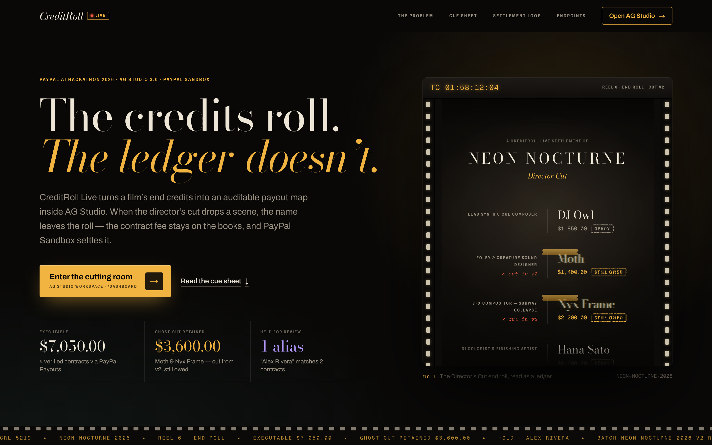
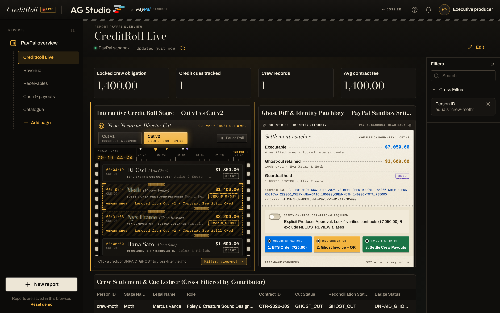
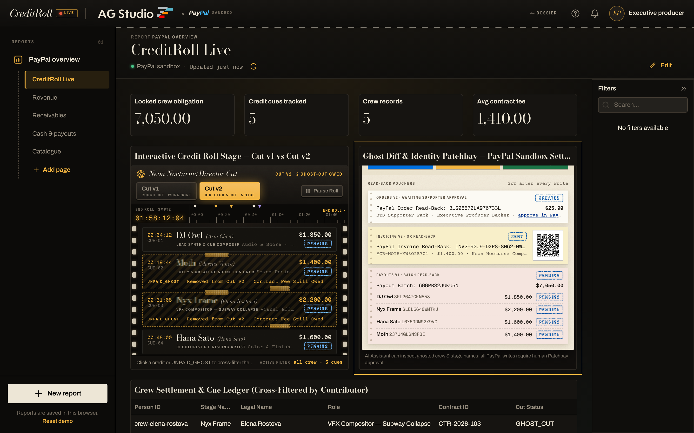

# CreditRoll Live — Interactive Cinema End-Credits & PayPal Sandbox Settlement Studio

> **PayPal AI Hackathon 2026 Submission** · Built with **PayPal Sandbox REST API** (`Orders v2`, `Invoicing v2 + QR Code`, `Batch Payouts v1`), **AG Studio 3.0 Custom Widgets & Studio Agent Framework**, and **Next.js 16**.

**CreditRoll Live** transforms the rolling end-credits of an independent film, animation, or indie game inside **AG Studio** into an interactive, auditable financial map powered by AI reconciliation, deterministic financial guardrails, and live **PayPal Sandbox** money movement.

---

## Hackathon Provenance & Commit Boundary (What Was Built During the Hackathon)

This project was built from scratch during the **PayPal AI Hackathon** submission period (**November 2–5, 2026**) on top of PayPal's official hackathon starter template (`paypaldev/ag-paypal-demo`):

- **Pre-Hackathon Official Starter Template (`c2d80f0..5de114e`, Sep 27 – Oct 12, 2026)**: Unmodified baseline commits from the official PayPal / AG Grid starter repository ([paypaldev/ag-paypal-demo](https://github.com/paypaldev/ag-paypal-demo), authored by Eddie Jaoude and James Swinton-Bland), which provided the initial Next.js + AG Studio boilerplate.
- **Built During the PayPal AI Hackathon (`ddad6e0..HEAD`, Nov 2 – Nov 5, 2026)**: 100% of **CreditRoll Live** was designed and implemented during the hackathon window, including:
  1. **Deterministic End-Credits & Completion-Bond Reconciler (`lib/credit-roll-reconciler.ts`)**: Cut v1 → Cut v2 `UNPAID_GHOST` detection (`Moth`, `Nyx Frame`), stage-name-to-legal-contract identity resolution, integer-cent guardrail verification (`discardedAiAmountOverrides`), and `NEEDS_REVIEW` hold on ambiguous aliases (`Alex Rivera`).
  2. **Three-Leg Live PayPal Sandbox Write & Read-Back Settlement Loop (`lib/paypal.ts`, `lib/credit-roll-settlement.ts`, `app/api/credit-roll/*`)**:
     - `Orders v2 CAPTURE` (`/api/credit-roll/supporter-order` & `/api/credit-roll/supporter-order/capture`) with `ORDER_NOT_APPROVED` buyer approval handoff and idempotent post-approval capture.
     - `Invoicing v2 + QR Code` (`/api/credit-roll/obligation-invoice`) generating and sending live `SENT` ghost-cut obligation invoices with base64 PNG QR codes.
     - `Batch Payouts v1` (`/api/credit-roll/settle`) with `PayPal-Request-Id` idempotency and per-item `transaction_status` read-back (`SUCCESS` vs `PENDING` / `UNCLAIMED`).
  3. **35mm Screening Room Dossier & Two Custom AG Studio 3.0 Widgets (`app/page.tsx`, `app/dossier.ts`, `app/dashboard/studio/credit-roll-widgets.tsx`)**: Full **"Midnight Cutting Table & Completion-Bond Ledger"** UI redesign, `CreditRollStageWidget` (24fps sprocket-lit end-credits stage with `widgetApi.toggleCrossFilter` into AG Grid), and `GhostPatchbayWidget` (ivory tear-off voucher desk with live PayPal Sandbox read-back receipts).
  4. **Automated acceptance tests** in the [tests directory](/tests) and a [public launch film](https://youtu.be/cE3SuZF7sic). The film is hosted on YouTube, not committed as an MP4.

---

## Visual Gallery

### The screening room — `/`

The home page reads the Director's Cut end roll as a ledger. Every credit carries its locked contract fee, the two names cut from v2 burn through the 35mm gate as `UNPAID_GHOST` double exposures, and the figures — $7,050.00 executable, $3,600.00 ghost-cut retained, one alias on hold — are computed by the same reconciler that drives AG Studio.



### The cutting room — `/dashboard`, Director's Cut v2 cross-filtered to Moth

The Credit Roll Stage widget sits on a flatbed: a sprocket-lit strip, an SMPTE cue ruler, and cyan workprint (Cut v1) and amber splice-tape (Cut v2) keys. Clicking Moth's ghost credit cross-filters the AG Grid ledger, the KPI tiles and the Filters panel to `crew-moth`, while the Ghost Patchbay beside it holds the integer-cent settlement voucher behind the producer's approval switch.



### The read-back desk — live PayPal Sandbox, after all three Patchbay actions

Captured from a live PayPal Sandbox run, not a mock. With the producer's approval switch armed, the Patchbay fired all three writes and read each one back with `GET`:

- **Orders v2**: order `31S06570LA976733L` was created for the $25.00 supporter pack. PayPal holds it as `CREATED` until a supporter approves it, so the voucher carries PayPal's approve link instead of claiming a capture. This screenshot predates the voucher's capture key described under the Supporter Pack flow below.
- **Invoicing v2**: Moth's ghost-cut invoice `INV2-9GU9-DXP8-8H62-NW6W` came back `SENT` for $1,400.00 with a scannable QR code.
- **Payouts v1**: batch `6GGPBS2JUKU5N` for $7,050.00 read back with all four items `PENDING`. Minutes later PayPal reported the batch `SUCCESS` and every item `UNCLAIMED`, because the demo crew addresses have no PayPal accounts, so no credit was ever stamped `PAID`.



---

## Why CreditRoll Live?

Independent film, animation, podcast, and indie game productions treat their end-credits roll as a static thank-you screen while managing contributor contracts, stage-name mapping, cut-edit changes, fan support, and PayPal payouts in disconnected spreadsheets:

1. **The "Ghost Credit" Cut Trap**: When a director trims a scene between the **Rough Cut (v1)** and the **Director's Cut (v2)**, a sound designer (`Moth`) or VFX artist (`Nyx Frame`) whose cue was cut often vanishes from the v2 credit roll—even though their approved fixed-fee contract remains legally owed and unpaid (`UNPAID_GHOST`).
2. **Stage-Name & Alias Mismatches**: Crew members credited under stage names (`DJ Owl`, `Moth`) or homonymous names (`Alex Rivera`) fail to match legal contract rosters, causing missed payouts or misdirected transfers.
3. **Batch Submission != Completed Settlement**: Submitting a payout batch does not mean every contributor was paid; individual items can return `SUCCESS`, `PENDING`, `UNCLAIMED`, or `FAILED` on read-back.

---

## Key Features

### 1. Two Native AG Studio Custom Widgets (`app/dashboard/studio/credit-roll-widgets.tsx`)
Registered via AG Studio's `createWidgets` API with full `formatShape` and `ai` metadata:
- **`credit-roll-stage` (Interactive Rolling Credit Roll Stage)**:
  - Play/pause cinema end-credits animation with a **Cut v1 (Rough Cut) ↔ Cut v2 (Director's Cut)** toggle. There is no rewind control.
  - Highlights contributors cut in v2 as glowing translucent **`UNPAID_GHOST`** nodes (*"Removed from Cut v2 · Contract Fee Still Owed"*).
  - Clicking any contributor chip or ghost credit invokes `widgetApi.toggleCrossFilter(...)` on `personId`, cross-filtering the companion **AG Grid** (`crewSettlements`, `creditCues`, `crewMembers`) to that contributor's cues, contract, and PayPal receipts.
- **`ghost-patchbay` (Ghost Diff & Identity Patchbay)**:
  - Side-by-side v1→v2 cut diff, stage-name-to-legal-contract evidence links, deterministic guardrail status (`NEEDS_REVIEW` hold on ambiguous alias `Alex Rivera`), and human-in-the-loop approval controls for triggering PayPal Sandbox writes.

### 2. Deterministic Financial Guardrail Engine (`lib/credit-roll-reconciler.ts`)
- Calculates all monetary amounts strictly in **integer cents** from the locked contract roster; any AI-suggested fee override is discarded and logged in `discardedAiAmountOverrides`.
- Generates deterministic, version-bound `proposalVersionHash`, `senderBatchId`, and `PayPal-Request-Id` identifiers so repeated clicks are idempotently deduplicated.
- Blocks unverified or ambiguous recipients (`NEEDS_REVIEW`) before any PayPal network request is sent.

### 3. Two-Way PayPal Sandbox Write & Read-Back Loop (`lib/paypal.ts` & `lib/credit-roll-settlement.ts`)
PayPal writes run server-side with `PayPal-Request-Id` headers. The settlement operations then read the resource back with `GET`; OAuth and QR generation are not resource read-backs:
- **Behind-the-Scenes Supporter Pack (`Orders v2 CAPTURE`)**: `POST /v2/checkout/orders` (`intent: CAPTURE`) → `POST /v2/checkout/orders/{id}/capture` → `GET /v2/checkout/orders/{id}` (`/api/credit-roll/supporter-order`). Until a supporter approves the order at PayPal's approve link, PayPal answers the capture with `ORDER_NOT_APPROVED`; the order is then recorded as pending (`CREATED`) with that link rather than failed. Once the supporter approves, the voucher's **Capture approved order** key calls `/api/credit-roll/supporter-order/capture`, which captures that order and reads it back `COMPLETED`; a repeat capture that PayPal answers with `ORDER_ALREADY_CAPTURED` is read back the same way. The test suite covers this step, but it has not yet been run against the live Sandbox.
- **Ghost-Cut Obligation Invoice & Live QR Code (`Invoicing v2`)**: `POST /v2/invoicing/invoices` → `POST /v2/invoicing/invoices/{id}/send` → `POST /v2/invoicing/invoices/{id}/generate-qr-code` → `GET /v2/invoicing/invoices/{id}` (`/api/credit-roll/obligation-invoice`).
- **Idempotent Crew Batch Payouts (`Batch Payouts v1`)**: `POST /v1/payments/payouts` → `GET /v1/payments/payouts/{batch_id}` (`/api/credit-roll/settle`), stamping a contributor node as `PAID` **only** when their individual item `transaction_status` is `SUCCESS` (while preserving `PENDING`, `UNCLAIMED`, and `FAILED` states).

---

## AI Review & Three-Minute Judge Walkthrough

Open the [screening room](https://paypal-credit-roll-live.onrender.com) and [dashboard](https://paypal-credit-roll-live.onrender.com/dashboard). The app has no login and needs no app test credentials. Render may cold-start; wait for the dashboard to finish loading.

1. Switch Cut v1 / Cut v2 and click Moth to cross-filter the ledger.
2. In Ghost Patchbay, press **AI · Review credits & contracts**. With `AG_STUDIO_OPENAI_API_KEY` or `OPENAI_API_KEY`, this sends fictional cue/contract data to the OpenAI Responses API. The default model is **gpt-4o-mini**; `OPENAI_MODELS` selects another provider-supported model. `OPENAI_BASE_URL` supports a compatible `/v1` endpoint for both this review and Studio chat. The receipt shows the provider-returned model, response ID, request ID and token usage, or explicitly says a field was not supplied.
3. Without a key, the review explicitly says **fallback: deterministic-local**, has no model receipt and makes no AI call. A configured provider failure returns an error; it is never presented as a local AI success. Review text is advisory and cannot change fees, recipients or settlement eligibility.
4. Inspect receipts without sending money. If testing a payout, tick producer approval and select **Test one crew payout · $0.01**. This sends one cent to one verified demo recipient and never settles a contract. Full crew payout is a separate action using locked contract amounts. Both require sufficient Sandbox funds, including fees; an insufficient-funds response explains the next step.

For supporter checkout, use your own **PayPal Sandbox personal buyer** account at PayPal's approval page; app login credentials are not required and no buyer password is published here. Approve at PayPal, return to the dashboard, then press **Capture approved order**. Keep the current tab/server alive: pending order receipts are held in memory. Set `APP_BASE_URL` to the deployed origin so return/cancel destinations point to that deployment. Creating the order alone does not charge a supporter.

Payout identifiers use a deterministic UUID derived from project, cut, revision, contract IDs, receiver addresses and integer amounts. The exact original demo proposal retains its previously submitted legacy key so this upgrade cannot issue that batch again under a new key. On a duplicate batch error after restart, the client reads the original PayPal batch from the error's batch link and verifies its sender ID; it does not mint a fresh transfer key. This relies on PayPal retaining the original batch and supplying its link; there is no durable local settlement database. Test payouts have separate keys. Formal settlement accepts the full approved roster only; an explicit full roster reuses the same key and a partial roster is rejected before any network request. Changing a proposal is not an instruction to repay an already settled contract: this demo is not a production payroll system.

The original implementation dates above describe the initial build; the audit remediation adds explicit AI review, redirect destinations and restart-safe batch recovery. Historical screenshots predate these controls. Internal `.scratch` files are excluded from the current tree; prior Git history is not rewritten.

## Quick Start & Local Verification

### Prerequisites
- **Node.js 20.9+** (tested on Node.js 24.22.1)
- **PayPal Sandbox REST App** credentials from [developer.paypal.com](https://developer.paypal.com/dashboard/applications/sandbox) (optional for initial UI exploration; required for live PayPal Sandbox network calls)

### 1. Install & Configure
```bash
npm install
cp env.example .env.local
```

Fill in `.env.local` with your PayPal Sandbox credentials:
```env
PAYPAL_CLIENT_ID=your_sandbox_client_id
PAYPAL_SECRET=your_sandbox_secret
# Optional license; AI key is required for real model review
AG_STUDIO=
AG_STUDIO_OPENAI_API_KEY=
OPENAI_API_KEY=
OPENAI_BASE_URL=https://api.openai.com/v1
OPENAI_MODELS=gpt-4o-mini
APP_BASE_URL=https://paypal-credit-roll-live.onrender.com
```

### 2. Run the Automated Test Suite (mocked API boundaries; no real transfers)
```bash
node --experimental-strip-types --test --test-concurrency=3 tests/*.test.ts
npx next typegen
npx tsc --noEmit
npm run lint
npm run build
```

### 3. Start the Application
```bash
npm run dev
```
Open [http://localhost:3000/dashboard](http://localhost:3000/dashboard) to launch the **CreditRoll Live** AG Studio workspace.

---

## Project Structure

```text
lib/credit-roll-reconciler.ts             Reconciliation engine, Ghost-Cut detection & deterministic guardrails
lib/credit-roll-settlement.ts             Server-side PayPal Sandbox settlement store & read-back state machine
lib/paypal.ts                             PayPal Sandbox REST client (OAuth, Orders v2, Invoicing v2 + QR, Payouts v1)
lib/dashboard-data.ts                     Relational data loader joining PayPal & CreditRoll Live tables
app/api/credit-roll/supporter-order/      POST routes for Orders v2 CAPTURE (+ capture/ after supporter approval) and GET read-back
app/api/credit-roll/obligation-invoice/   POST route for Invoicing v2 draft + send + QR generation + GET read-back
app/api/credit-roll/settle/               POST route for human-approved Batch Payouts v1 + GET read-back
app/dashboard/studio/credit-roll-widgets.tsx        Interactive Credit Roll Stage & Ghost Patchbay Custom Widgets
app/dashboard/studio/credit-roll-widget-state.ts    AG Studio Custom Widget definitions, cross-filter & action store
app/dashboard/studio/data.ts              AG Studio relational schema (crewMembers, creditCues, crewSettlements)
tests/                                    Acceptance and regression tests with mocked PayPal / AI network boundaries
```

---

## License

Released under the [MIT License](LICENSE).
