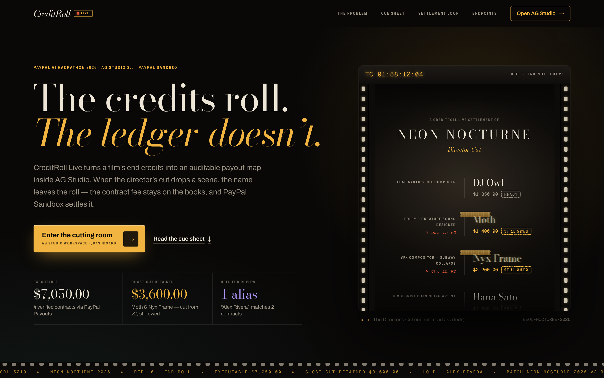
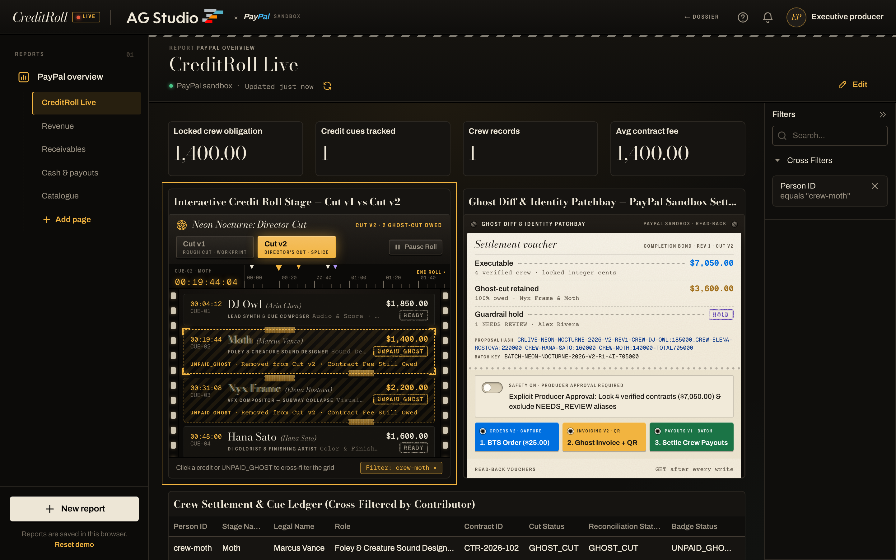
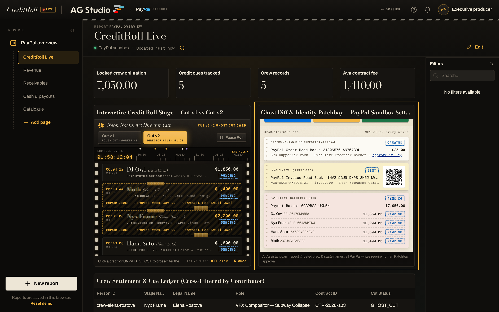

# CreditRoll Live

## Inspiration

A director can cut a scene without cancelling the crew member's contract. CreditRoll Live keeps those two facts visible together: Moth and Nyx Frame disappear from the director's cut, but their approved fees remain owed. An ambiguous stage name such as Alex Rivera stays on hold instead of becoming a payment recipient.

## What it does

The AG Studio dashboard connects an interactive end-credits strip, a contract ledger and PayPal Sandbox receipts. Switch between the rough cut and director's cut, then click a contributor to cross-filter the grid.

The Ghost Patchbay's “AI · Review credits & contracts” button sends the fictional cue sheet and contract roster to the OpenAI Responses API. It asks the model to cite cue and contract IDs when explaining removed credits, stage names and unresolved aliases. The default model is gpt-4o-mini. Deployments can select another supported model with OPENAI_MODELS and an OpenAI-compatible endpoint with OPENAI_BASE_URL. The UI reports the actual returned model, response ID, request ID and token usage; missing provider fields are labelled as unavailable.

The AI review is advisory. Locked integer-cent fees, verified recipients and human approval control settlement. With no API key, the review explicitly displays “fallback: deterministic-local” and makes no model call. A configured provider error stays an error rather than silently becoming an AI result.

## PayPal integration

All payment operations use PayPal Sandbox:

- Orders v2: create a supporter order, hand off to PayPal buyer approval, capture the approved order and read it back. Return and cancel destinations point to the configured application origin.
- Invoicing v2: create and send an obligation invoice, generate its QR code and read the invoice back.
- Payouts v1: submit a producer-approved batch and read individual payout statuses. Only an item's SUCCESS marks its contract paid. PENDING and UNCLAIMED remain visible.
- A separate one-cent payout tests one verified recipient without settling the real contract. Insufficient funds produce a readable diagnostic.

The API calls are POST /v2/checkout/orders, POST /v2/checkout/orders/{id}/capture, GET /v2/checkout/orders/{id}, POST /v2/invoicing/invoices, POST /v2/invoicing/invoices/{id}/send, POST /v2/invoicing/invoices/{id}/generate-qr-code, GET /v2/invoicing/invoices/{id}, POST /v1/payments/payouts and GET /v1/payments/payouts/{batch_id}. The starter also reads catalog products, billing plans, invoices, transactions and balances.

## Try it in three minutes

1. Open the [dashboard](https://paypal-credit-roll-live.onrender.com/dashboard). The application needs no login or app test credentials. Allow the Render service to cold-start.
2. Toggle the cut version and click Moth to inspect the retained obligation in the grid.
3. Press “AI · Review credits & contracts” in Ghost Patchbay and inspect the review and provider receipt. A deployment without a key will explicitly show the local fallback.
4. Inspect the PayPal controls and historical receipts. If testing payouts, tick producer approval and choose “Test one crew payout · $0.01”; sufficient Sandbox balance and fees are still required. The full crew batch is a separate action.

For supporter checkout, use your own PayPal Sandbox personal buyer account on PayPal's approval page. No buyer password is distributed with this project. Return to the same dashboard and use “Capture approved order”. Keep the current tab and server alive because pending order receipts are stored in memory.

Watch the [launch film](https://youtu.be/cE3SuZF7sic) or browse the [source and setup instructions](https://github.com/GGGODLIN/paypal-credit-roll-live/blob/main/README.md).

## How we built it

CreditRoll Live extends the [official PayPal AG Studio starter](https://github.com/paypaldev/ag-paypal-demo) with a deterministic reconciler, two custom AG Studio widgets, server-side PayPal operations and an explicit AI contract review. It uses Next.js, React, TypeScript, AG Studio and AG Grid. The [reconciler](https://github.com/GGGODLIN/paypal-credit-roll-live/blob/main/lib/credit-roll-reconciler.ts), [PayPal client](https://github.com/GGGODLIN/paypal-credit-roll-live/blob/main/lib/paypal.ts) and [AI review](https://github.com/GGGODLIN/paypal-credit-roll-live/blob/main/lib/credit-roll-ai.ts) are available in the repository.

## Challenges and limits

A submitted batch is not proof that each crew member was paid. The dashboard therefore preserves PayPal's individual item statuses. Stable payout identifiers bind the proposal's recipients and amounts; when PayPal returns a duplicate batch link after a restart, the client reads that original batch instead of generating a new transfer key.

This remains a Sandbox demonstration without a durable settlement database or app authentication. PayPal's duplicate recovery depends on its retained batch and returned link. A changed proposal is not authorization to pay an already settled contract again. The credit animation has play/pause and cut switching, with no rewind control. Screenshots and the launch film predate the audit remediation controls.

Automated tests use mocked external API boundaries. They cover payloads, read-back, guardrails, duplicate recovery, the separate small test payout and true-provider versus local-fallback routing; they do not by themselves prove a deployed account has a working model key or funded Sandbox balance.
